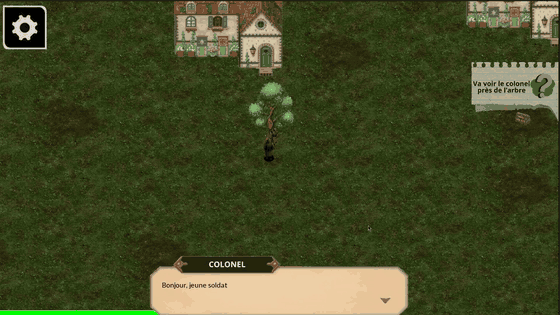
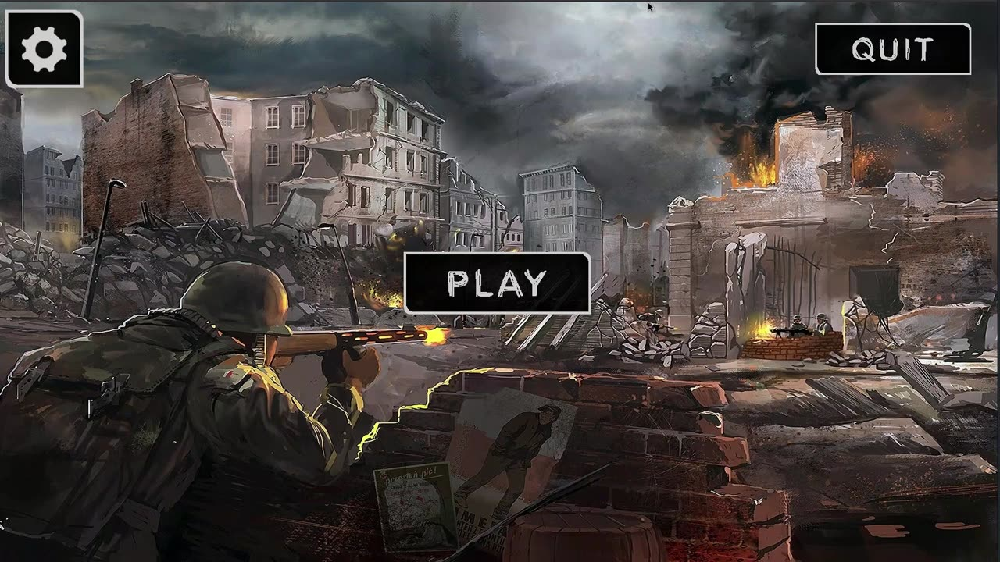
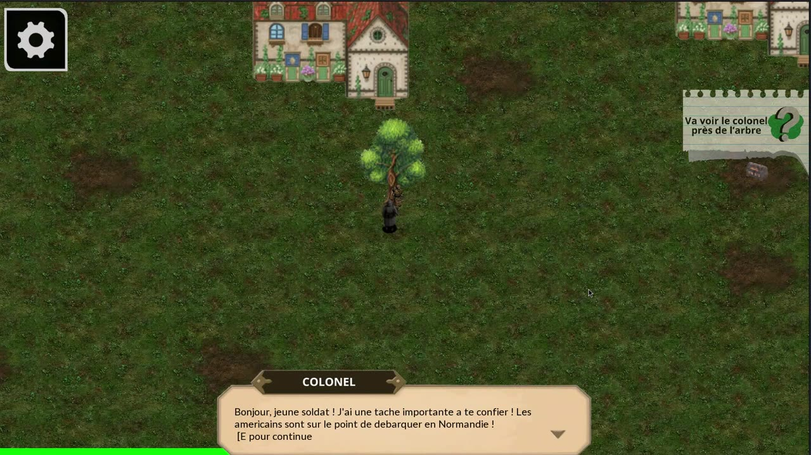
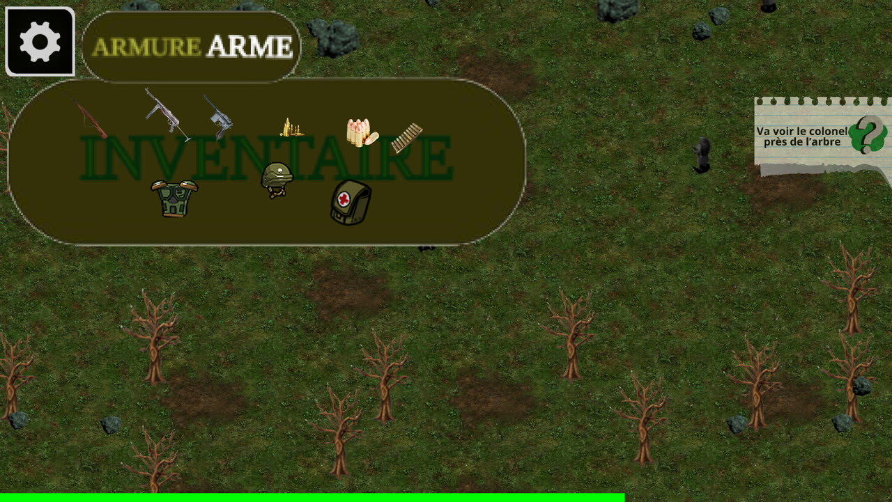
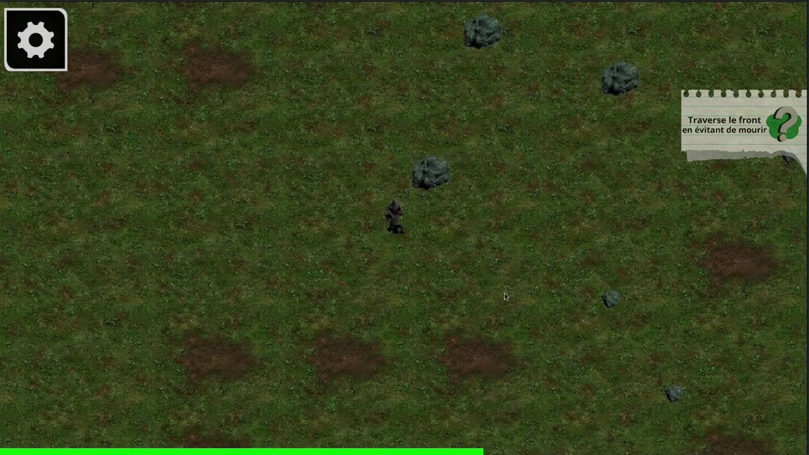
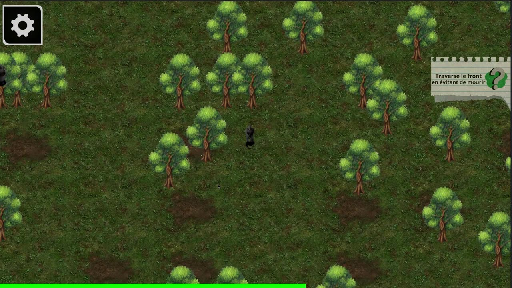
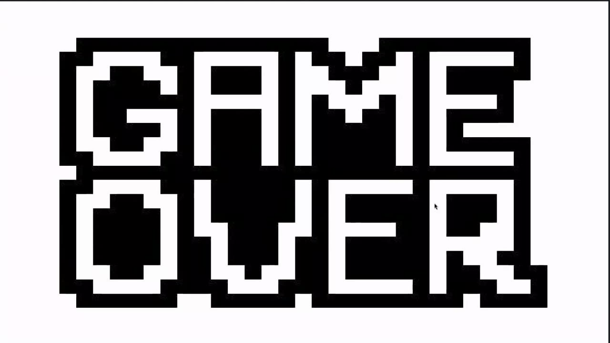

# Front Messenger — RPG en vue de dessus, CSFML (Epitech, 1re année)

> **EN** — Top-down WW2 RPG written in C with CSFML (Epitech `my_rpg`, Apr.–May 2024, team of 4). You play a
> messenger who must cross the front line: dialogues, chests, inventory and weapons, enemy tanks that chase you,
> pixel-perfect collisions, three save slots and settings (720p / 1080p, 60 / 120 FPS, sound, music).

**Front Messenger** est le `my_rpg` d'Epitech : un jeu de rôle complet en C, sans moteur, avec la bibliothèque
graphique CSFML. Normandie, 1944 : un colonel vous confie un message pour une base alliée coupée du monde, à
l'autre bout du front. Il faut descendre vers le sud, ramasser armes et munitions dans les coffres, traverser
la forêt puis la ligne de front tenue par des chars, sans mourir.

🎬 Bande-annonce : [media/trailer.mp4](media/trailer.mp4)

| Menu | Mission |
| --- | --- |
|  |  |
| **Inventaire** | **La ligne de front** |
|  |  |
| **Forêt** | **Fin de partie** |
|  |  |

## Le jeu

- **Quête** : un colonel ouvre et clôt l'aventure par des dialogues qui s'écrivent lettre à lettre ; un encart
  rappelle l'objectif en cours (« Va voir le colonel près de l'arbre », puis « Traverse le front en évitant de mourir »).
- **Exploration** : grande carte en vue de dessus, herbe en tuiles, décor (arbres, maisons, rochers, rails)
  placé depuis un fichier de données, limites de carte en barbelés. Le personnage passe derrière les objets
  du décor pour donner de la profondeur.
- **Combat** : des chars patrouillent et poursuivent le joueur dès qu'il s'approche ; on les détruit avec
  plusieurs armes (pistolet, pistolet-mitrailleur, arme lourde), chacune avec sa cadence et ses dégâts.
  Un train traverse la carte. Barre de vie, expérience gagnée, écran Game Over.
- **Inventaire** (`F`) et **coffres** (`E`) : armes, munitions, casque, gilet, trousse de soin, glisser-déposer
  entre le coffre et l'inventaire, emplacements arme et armure.
- **Sauvegardes** : trois parties ; position, équipement et ennemis encore en vie sont sauvegardés.
- **Réglages** : 1280×720 ou 1920×1080, plein écran, 60 ou 120 FPS, son et musique, page d'aide, accessibles
  depuis le menu et en jeu.

Commandes : `Z` `Q` `S` `D` pour se déplacer (clavier AZERTY), `E` pour parler et ouvrir un coffre, `F` pour
l'inventaire, clic gauche pour tirer.

## Technique

- C, norme de code Epitech, environ 4 000 lignes dans 43 fichiers, CSFML (graphics, window, system, audio).
- **Collisions au pixel** : chaque objet du décor a un masque (`assets/collision/`) ; le déplacement teste
  chaque pixel dans la direction du mouvement.
- **Décor piloté par les données** : `info/doc` liste, pour chaque sprite, son rectangle et toutes ses positions.
- **Caméra** : une vue SFML suit le joueur ; l'interface (réglages, objectif, vie) est dessinée par-dessus.
- **IA** : poursuite du joueur dans un rayon donné, animation des chars selon leur direction, points de vie.
- **Changement de résolution à chaud** : la fenêtre est recréée et l'interface replacée.

Architecture : [docs/ARCHITECTURE.md](docs/ARCHITECTURE.md) · Installation : [docs/INSTALL-fedora.md](docs/INSTALL-fedora.md)

## Mon rôle

Projet à **quatre** (avril–mai 2024) avec Raphaël Gall, Iness El Atouani et Arthur Deson. J'ai écrit la
majorité du code (101 commits sur 122) :

- menus et réglages : boutons de sauvegarde, résolution 720p / 1080p et plein écran, 60 / 120 FPS, son et
  musique, page d'aide, réglages accessibles en jeu ;
- déplacement et animations du personnage dans toutes les directions, collisions au pixel, effet de profondeur
  derrière le décor, herbe en tuiles, barbelés en limite de carte, décor lu depuis un fichier ;
- chars : animations, conduite, collisions, création des ennemis depuis un fichier, IA de poursuite ;
- inventaire et armes (sélection, dégâts différents par arme), dialogues du colonel, astuces, rails et train ;
- sauvegarde et chargement (position, armure, ennemis vivants), barre de vie, expérience, écran Game Over,
  écran de chargement, passes de norme de code.

Mes coéquipiers ont posé la structure de départ, le menu, ses boutons et la musique (Iness), l'aide, le
glisser-déposer des objets et les coffres (Raphaël), et une partie du travail sur le décor (Arthur).

## Code source

Le code source et son historique complet sont dans un dépôt privé :
[FuniclemDev/my-rpg-source](https://github.com/FuniclemDev/my-rpg-source) (accès sur demande).
Ce dépôt public ne contient que la présentation, la documentation et les médias : le code des projets Epitech
n'est pas publié en accès libre.

---
Clément Dorge · [clementdorge.com](https://clementdorge.com/fr/projets/my-rpg/) · Epitech Strasbourg
